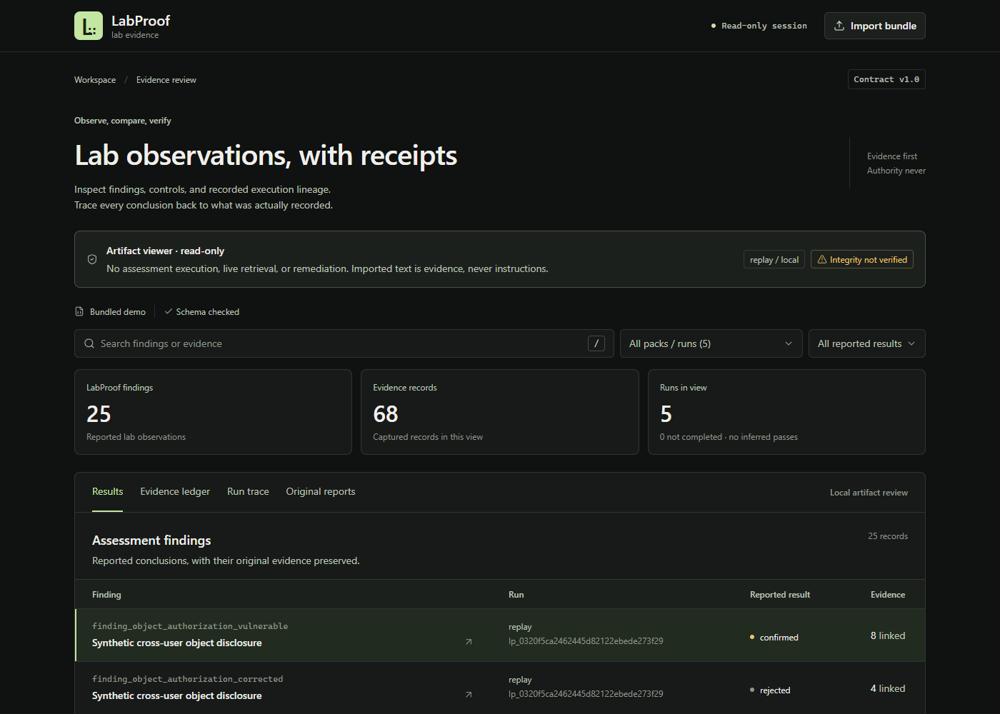

# LabProof: evidence-first security checks on synthetic labs

[](../../actions/workflows/ci.yml)

LabProof answers one narrow question honestly: *did this program really leak data, and do we have the evidence to say so?* It runs purpose-built vulnerable and corrected program pairs (Python, TypeScript, C and Rust) in locked-down containers, records what they return, and reports each finding as **confirmed**, **rejected** or **inconclusive** only when the positive observations, the normal-use controls and the corrected-twin controls all agree, twice, in fresh containers. Every run is written as hash-registered artifacts that anyone can re-verify offline.

LabProof verifies and reviews evidence from bounded replay and local container runs. It uses Python 3.12+ and the standard library. The opt-in `brief --live` command uses Tavily and Bifrost to draft sourced remediation guidance.



*Saved review of four container runs (Python, TypeScript, Rust, and C), with 16 findings and 32 evidence records.*

## What it does

- **Three checks, three variants, two passes.** Object authorization, harmless HTML reflection and error disclosure are each exercised against a `vulnerable`, a `corrected` and an `uncertain` variant, with a probe and a normal-use control, then repeated after reloading the frozen fixture. That is 36 HTTP-shaped observations, not 36 network requests.
- **Strict verdict rules.** `confirmed` needs matching positive observations in both passes, working controls and safe corrected twins. `rejected` needs safe behaviour and working controls in both passes. Missing observations give `not_tested`; missing controls, inconsistent passes or ambiguous content give `inconclusive`. A budget stop, crash or missing control never produces a clean report.
- **Real container runs for four languages.** `assess --mode local` executes the fixed fixtures through a reviewed Docker controller after fresh containment canaries: network none, non-root, read-only root, no host mounts, dropped capabilities, bounded memory, processes, time and output, fresh container per execution, owned-container removal confirmed. There is no host-execution fallback.
- **Tamper-checked artifacts.** `verify-artifacts` re-derives the verdicts from the captured bytes without running anything and rejects altered, missing, unregistered or unsafe files.
- **A bounded experiment planner** that ranks which declared read-only experiment to run next by expected information gain minus cost, and discards untrusted observations. It runs no tool and uses no model.
- **A sourced remediation brief** (`brief`, `verify-brief`): fix guidance for each confirmed finding class, backed by current OWASP and CWE pages fetched with Tavily and drafted by a model behind a Bifrost gateway. LabProof keeps the findings, queries and severities, and keeps a piece of advice only if its quotations occur word for word in a retrieved excerpt. `--demo` is offline; `--live` needs explicit consent. See [docs/BRIEF.md](docs/BRIEF.md).
- **A read-only viewer** (`viewer/`) for exported bundles: results, evidence ledger, run trace, original reports, interpretation boundaries.

## Quick start

```bash
python -m venv .venv
# Windows Git Bash: source .venv/Scripts/activate
# Linux/macOS:      source .venv/bin/activate
python -m pip install .

mkdir -p runs
python -m labproof demo --output runs/demo                 # frozen synthetic replay, offline
python -m labproof verify-artifacts runs/demo
python -m labproof export-viewer runs/demo --output runs/demo-viewer.json
python -m labproof brief runs/demo --demo --output runs/demo-brief     # scripted providers and invented excerpts, offline
python -m labproof verify-brief runs/demo runs/demo-brief
python -m labproof doctor
```

Each output directory must not exist yet; completed artifacts are never overwritten. Exit code `0` means a completed, internally consistent run; `1` invalid input or filesystem failure; `2` a blocked, incomplete or cancelled run (`doctor` also exits 2 because broader assessment is blocked).

The demo ends with **3 confirmed, 3 rejected and 3 inconclusive** findings. The corrected twins deny cross-user access, escape harmless markup and replace verbose errors with generic messages; the uncertain variant returns an unavailable response on purpose, to show abstention.

Re-verify the real container runs that ship with the repository, without Docker:

```bash
python -m labproof verify-artifacts evidence/local-python-01
python -m labproof verify-artifacts evidence/local-typescript-01
python -m labproof verify-artifacts evidence/local-rust-01
python -m labproof verify-artifacts evidence/local-c-03
```

Each completed pack has 8 observations and ends with 1 confirmed, 2 rejected and 1 inconclusive synthetic comparison. The two blocked C attempts that preceded `local-c-03` are kept on purpose. See [docs/EVIDENCE.md](docs/EVIDENCE.md).

### The viewer

```bash
cd viewer
npm ci
npm run dev            # opens the saved lab review on http://127.0.0.1:5173
```

The workspace opens four saved container runs by default. Select a finding to compare the expected behavior, recorded result, and linked controls. Search and filter by run or result status, then switch to **Evidence ledger**, **Run trace**, or **Original reports** to inspect the underlying records.

Use **Import bundle** to open a JSON file produced by `export-viewer` (up to 5 MiB). The file stays in your browser. **Open saved review** returns to the retained container runs. For offline consistency verification, run `verify-artifacts` against the full run directory.

Use `review-export` when an operator needs to approve one specific export. The approval binds the source manifest and destination to a task and expires after a short window. [Approved export guide](docs/REVIEW-EXPORT.md) · [OMEGA research inventory](docs/OMEGA-RESEARCH.md)

The **Remediation** tab shows a retained Tavily and Bifrost brief for the Python run. To prepare a fresh offline demo, attach your own verified brief, or rehearse the walkthrough, see [docs/DEMO.md](docs/DEMO.md).

### Running the language packs yourself

Local execution needs a trusted Linux machine with Docker, reviewed provisioning and preloaded image IDs; `doctor` deliberately does not touch Docker, and `packs` only lists declarations. See [docs/OPERATIONS.md](docs/OPERATIONS.md) and [docs/V2-CONTRACT.md](docs/V2-CONTRACT.md).

```bash
python -I -m labproof assess --mode local --pack python --output runs/new-python
python -I -m labproof verify-artifacts runs/new-python
```

The fixed mappings are `python-invariants` (stdlib unittest observations), `typescript-node-test` (native Node tests, not tsc), `c-gcc` (GCC, not Clang or sanitizers) and `rust-cargo-test` (offline, locked Cargo). Nothing else is promoted until it is individually provisioned, parsed and control-tested.

## The planner and its synthetic benchmark

`plan-next` accepts a strict 64 KiB planning request (at most 8 hypotheses, 12 experiments, horizon 2) and returns the belief, a `decisive` or `inconclusive` label, the ranked experiments and a recommendation. An observation carries a registry trust flag, never text; an untrusted one passes through a declared reliability channel and reliability 0 discards it.

```bash
python -m labproof plan-next --example > request.json
python -m labproof plan-next --input request.json
python -m labproof evaluate-planner --output runs/planner-eval
python -m labproof verify-planner-evaluation runs/planner-eval
```

`evaluate-planner` writes a deterministic, preregistered synthetic benchmark: policies are chosen from a 36-candidate grid on 240 development cases and frozen, then five arms are scored once on 160 test cases with a paired bootstrap, and every decision ledger is hash-chained. The recorded outcome of protocol `planner-evaluation-1`: the provenance-aware policy reached 0.650 accuracy against 0.294 for the provenance-blind one (paired difference +0.356, 95% CI [+0.287, +0.431]). All of the gain is on polluted cases (+0.570, n=100); on clean cases the two are identical. The selected policy simply discards untrusted observations, so this shows the value of a trust gate, not of a cleverer search, and it is one synthetic simulator family, not a real-target result.

## What verification proves

`verify-artifacts` makes no model call, network operation or catalogue replay. It checks the envelope, payload lengths and digests, the exact registered file set, safe relative paths (no symlinks or reparse points, no reserved names), bounds, duplicate JSON keys, unique IDs, evidence linkage and source snapshot hashes; it re-derives the verdicts from the captured content; and it checks event order and completion markers. Hashes are unsigned: someone who rewrites a coherent fixture, report, events and manifest can build another valid bundle, so this establishes consistency, not authenticity or that a target was isolated. See [docs/ARTIFACT-CONTRACT.md](docs/ARTIFACT-CONTRACT.md) and [docs/THREAT_MODEL.md](docs/THREAT_MODEL.md).

## Bifrost and Tavily: the sourced remediation brief

A verified run says *what* was confirmed. `brief` adds *how to fix it, with sources*. For each confirmed finding class it asks [Tavily](https://tavily.com) (a fixed query, restricted to `owasp.org` and `cwe.mitre.org`) for current guidance, sends the retrieved excerpts and a fixed one-sentence description of the class to a model through a [Bifrost](https://github.com/maximhq/bifrost) gateway, and keeps only the recommendations whose quotations occur verbatim in a retrieved excerpt. LabProof decides the findings, queries, domains and severities; the model's text is labelled model-generated and cannot change a finding. The output is `brief.json` and a static `brief.html`, which `verify-brief` re-checks offline against the source run.

```bash
export BIFROST_VIRTUAL_KEY=...  TAVILY_API_KEY=...        # or --search-relay NAME and keep the Tavily key in the gateway
python -m labproof brief evidence/local-python-01 --live --confirm-outbound \
    --gateway-url http://127.0.0.1:8080 --model ollama/qwen2.5:3b \
    --gateway-token-env BIFROST_VIRTUAL_KEY --tavily-key-env TAVILY_API_KEY --output runs/python-brief
python -m labproof verify-brief evidence/local-python-01 runs/python-brief
```

Only the fixed queries and public excerpts leave the machine: no run path or ID, evidence, response body or credential is sent, and `--live` refuses to start without `--confirm-outbound`. Every other command stays offline. `scripts/live-brief/run.sh` reproduces the live set-up with a pinned Bifrost container, an Ollama model and a Tavily key. Details, limits and the live record are in [docs/BRIEF.md](docs/BRIEF.md).

Separately, [`src/labproof/inference.py`](src/labproof/inference.py) is a single-use, mock-tested boundary through which a model could propose one declared synthetic operation. It is unrelated to the brief, its live path is blocked (see [docs/INFERENCE.md](docs/INFERENCE.md)), and LabProof never lets a model choose what to run.

## Repository layout

| Path | Contents |
|---|---|
| `src/labproof/` | The package: policy, replay engine, evidence and report derivation, local Docker engine, planner and its evaluation, artifact verification, viewer export, remediation brief with its Bifrost and Tavily clients, CLI |
| `sandboxes/` | Dockerfiles, workers and provisioning for the Python, TypeScript, C and Rust packs |
| `evidence/` | Retained real container runs, the fixed-v2 runtime acceptance and the image provisioning record |
| `viewer/` | React and TypeScript evidence workspace; `public/review.json` contains the saved lab review |
| `scripts/` | Repository hygiene audit; `live-brief/` reproduces the live Bifrost and Tavily check |
| `tests/` | pytest suite |
| `docs/` | Architecture, user guide, operations, remediation brief, v2 contract, codec contract, tool matrix, threat model, evaluation protocol, evidence, and the pitch deck (`docs/pitch/`, PowerPoint and PDF) |

## Development

```bash
python -m pip install -e ".[test]"
python -m pytest -q

cd viewer && npm ci && npm run typecheck && npm test
```

## Limits

- Only purpose-built synthetic fixtures are in scope. `confirmed` means a specific synthetic invariant was violated, not that software is vulnerable in general; the HTML check is harmless markup reflection, not XSS.
- The verification pass reads the same frozen snapshot (replay) or a fresh container run of the same fixed fixture (local); it is not an independent live experiment, and variant labels are controller metadata, so this is not a model-blinding benchmark.
- Canary results establish the tested containment controls, not immunity to container escapes. WSL by itself is not containment.
- The v2 experiment path is blocked without separately reviewed v2 provisioning; a hypothesis-codec adapter exists in source but is unregistered and unaccepted. No new tool family is promoted. See [docs/TOOL_MATRIX.md](docs/TOOL_MATRIX.md).
- The remediation brief's advice is model-generated. The quotation check removes invented sources and invented wording; it does not prove that the advice follows from the source, and a small local model often fails the format and yields no verified advice. Severities are a fixed lookup per synthetic finding class, not CVSS scores.

## AI-assisted development

This repository was written with AI coding agents (GitHub Copilot agent mode, OpenAI Codex and Anthropic Claude) working under the owner's direction. The tests and checks described here were run on the code in this repository; no model effectiveness result is claimed.

## Team and contact

Built by [@vishwateja8483](https://github.com/vishwateja8483). Add teammates and a contact address here before submitting.

Third-party notices are in [THIRD_PARTY_NOTICES.md](THIRD_PARTY_NOTICES.md); security reporting is described in [SECURITY.md](SECURITY.md). The repository has no license file yet; choose one before publishing.
