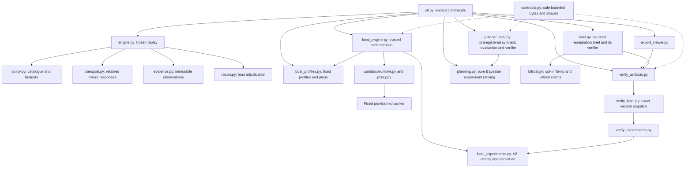
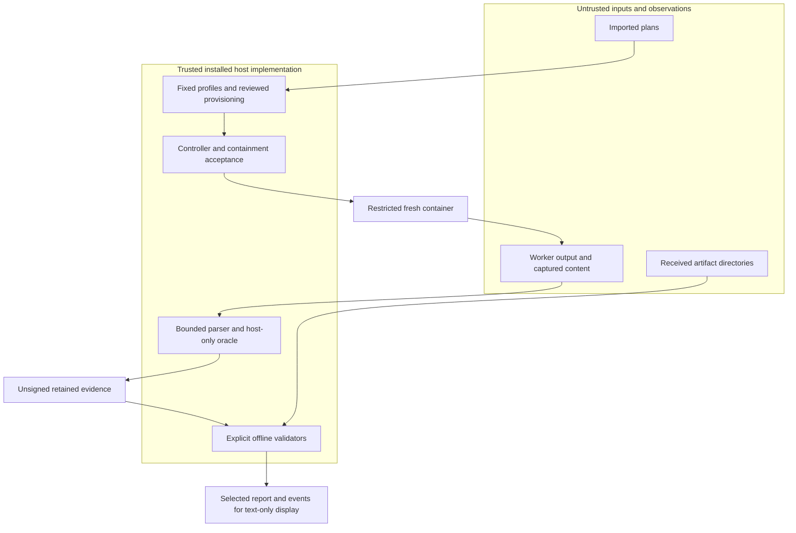

# LabProof architecture

## Scope and navigation

LabProof is an independent Python 3.12+ package with a standard-library runtime. It provides frozen synthetic replay, legacy provisioned local experiments, a blocked-by-default v2 experiment foundation, offline artifact verification, and its own viewer export. It does not assess arbitrary repositories, URLs, commands, or public software security.

Paths in this document are relative to the repository root, which contains `README.md`, `pyproject.toml`, `src/`, and `docs/`. Related documents in this documentation set are `USER-GUIDE.md`, `DEVELOPMENT.md`, `OPERATIONS.md`, and `V2-CONTRACT.md`.

**Current gate:** `src/labproof/fixtures/local-provisioning-v2.json` is not supplied. V1 provisioning cannot satisfy v2. The Hypothesis codec parser, driver, and fixture sources present in the tree are unregistered and unexecuted as an accepted capability. Their presence does not change this gate.

## Module boundaries



`packs.py` is the broader operation catalogue; catalogue declarations do not authorize launches. `local_profiles.py` owns the narrower immutable mappings: `python-invariants`, `typescript-node-test`, `c-gcc`, and `rust-cargo-test`. Python's accepted legacy adapter uses stdlib observations, not Hypothesis; Node is not TypeScript compiler validation; GCC is not sanitizer acceptance.

`planning.py` and `planner_eval.py` are pure host code with no edge to the sandbox, a worker, the network or a model. The planner only ranks experiments the caller declared; it returns a recommendation and never builds a launch plan. The evaluation is a pure function of its source, so its verifier recomputes every artifact instead of trusting stored hashes.

The proposal/inference boundary is separate from these deterministic paths. Neither replay nor local execution calls a model. It cannot be used to bypass profile validation or promote worker output into findings.

`brief.py` is the one place outside that boundary that can reach the network, and only through `bifrost.py` with `--live --confirm-outbound`. It starts from a run that already passed `verify_artifacts.py`, re-derives the confirmed findings itself, sends only a fixed query and public excerpts out, and accepts model text only after its own checks. It has no edge to the sandbox, a worker or the evidence of a run, and its verifier (`verify-brief`) makes no network call. See [BRIEF.md](BRIEF.md).

## Data and authority


A v2 plan has exactly `schema_version`, `profile_id`, `budgets`, and `steps`. Each step has `id`, `request`, `phase`, and `replay_of`. Observation steps have null replay links. Verification steps name an earlier observation and repeat its **entire** validated request. Duplicate request/phase slots, cross-profile requests, forward links, and unknown fields reject.

The six-step default observes alpha/beta/gamma and then replays each. Initial profiles allow one to eight steps, with bounded action/wall/output budgets. A syntactically valid smaller plan need not satisfy required controls. A plan cannot supply images, executable paths, arbitrary argv, parsers, graders, or registrations.

Evidence identity binds the full request and phase, step/replay relation, worker/container/reset identities, image/policy/runtime/provenance, raw digest, and parsed observation. Cross-step identity reuse is forbidden; equal worker/container/reset aliases within one returned runtime result are allowed. Host-only oracles are distinct from worker-visible fixture source. Old combined fixture hashes cannot be renamed into the v2 source/oracle split.

## Execution sequence and end states

```mermaid
sequenceDiagram
    participant U as Caller
    participant C as CLI and controller
    participant P as Trusted provisioning
    participant S as LiveSandboxSession
    participant A as Artifact directory
    U->>C: experiments --plan FILE --output NEW_DIR
    C->>C: Validate plan before attempting execution
    C->>P: Load separate package-local v2 record
    alt Missing provisioning (current distribution)
        P-->>C: Gate failure
        C->>A: blocked, no attempted workers, retained error
        C-->>U: JSON status; exit 2
    else Separately reviewed provisioning and environment
        C->>S: Fixed launch plans and fresh containment acceptance
        loop Each bounded plan step
            C->>C: Reserve wall, cleanup, output and action ceiling
            C->>A: Retain attempted step
            C->>S: Execute fixed operation in fresh worker
            S-->>C: Raw bytes and controller metadata
            C->>C: Parse, bind identity, assess completion
        end
        C->>A: Report, events, errors, raw records, manifest
        C-->>U: completed or honest noncomplete status
    end
```

The provisioned branch describes implemented orchestration, **not current v2 runtime acceptance**. Containment checks have their own fixed bounds and are excluded from aggregate experiment budgets. Each experiment reserves a full per-worker wall-plus-cleanup and output ceiling before launch; observed consumption alone is not permission to overbook the next attempt.

Four different facts remain separate: controller completion (`completed`/`interrupted`), nullable child exit code, parser status (`parsed`/`unrecognized`/`unavailable`), and host-derived finding. Nonzero child exit, ambiguity, truncation, timeout, missing controls, or incomplete plans cannot confirm a defect.

Report usage distinguishes attempts, unreturned attempts, parsed/completed steps, attempted/completed replays, elapsed seconds, and retained bytes. If a controller attempt never returns a result, its action remains counted and total elapsed time becomes null, not zero. Target invocations, rejections, and shrinks are null for the existing uninstrumented adapters. A framework limit is not a measured invocation count.

## Artifact versions

| Layer | Replay / local v1 | Local v2 |
|---|---|---|
| Manifest | `schema_version: "1.0"` | Same envelope, `mode: "local"` |
| Domain config/report | Replay config or `local-config-1` / `local-report-1` | `local-config-2` / `local-report-2` |
| Plan | Legacy fixed schedule | `experiment-plan-2` embedded in config/report |
| Viewer | Envelope `1.0` | Envelope `1.0`, report stays `local-report-2` |

Replay retains `fixture.json`; local v1 retains acceptance, executions, raw output and parsed evidence. V2 additionally retains `attempts.json` and explicit plan/completion accounting. All retain config, report, events, errors, and manifest. Unknown or mixed versions fail closed; an envelope version never implies domain compatibility.

LabProof has **no frozen-run comparison command**. Inspection may compare reports side by side, but this is not a product-derived change attribution. V2 `experiments`, `completion`, `usage`, and finding `observed`/`evidence_ids` explain a run.

## Trust diagram and assurance



Workers have no network, host mounts, Docker socket, secrets, or authority to decide findings. Reviewed local policies constrain user, capabilities, filesystem, memory, CPU, PIDs, scratch, output, and cleanup. Canary acceptance covers tested controls, not every possible container escape. There is no host-execution fallback.

Offline verification validates safe paths, byte bounds/digests, identities, event ordering, raw parsing, domain derivation, and completion without running fixtures. Unsigned consistency is not source authenticity, proof that execution occurred, or proof of containment. Viewer exports omit raw artifacts and are for inspection, not independent browser verification. Keep complete static runs and render captured content as escaped text.
