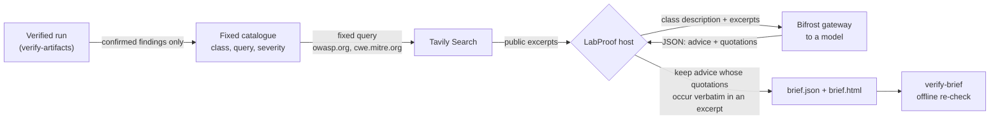

# Sourced remediation brief (Bifrost and Tavily)

`labproof brief` turns a verified run into a short, source-backed remediation brief for the people who have to fix what the run found. It is the only part of LabProof that can use the network, and it does so only when you ask.

- **Tavily Search** supplies current public guidance (OWASP and CWE pages) and its provenance: URL, title, publication date, excerpt.
- **A model behind a Bifrost gateway** drafts one to three sentences of remediation per finding class, using only those excerpts. Bifrost is the governed path to the model: virtual key, budget, rate limits, fallbacks, and optionally a relay that keeps the Tavily key out of the client.
- **LabProof (the host) decides everything that matters** and checks everything the model returns. Findings are re-derived from the verified run, queries come from a fixed catalogue, and a piece of advice survives only if every quotation attached to it occurs word for word in an excerpt that was actually retrieved.

The result is two files, `brief.json` (canonical JSON, schema `labproof-brief-1`) and `brief.html` (a static page: no script, no network, `default-src 'none'`), that `labproof verify-brief` re-checks offline.



## Who decides what

| Decision | Decided by |
|---|---|
| Which findings exist | The verified run. They are re-read from `report.json` after `verify-artifacts` passes, never from a brief, a search result or a model. Only `confirmed` findings are used |
| Which queries run | A fixed catalogue, one query per finding class (below). The model never chooses or edits a query |
| Which web pages count | A host allow-list: `owasp.org` and `cwe.mitre.org` (and subdomains). Anything else is dropped before the model sees it |
| Severity | A fixed rating per finding class, with its reason. It is a rating of the synthetic finding class, not a CVSS score |
| Which advice is kept | The host: 1 to 3 quotations of 20 to 300 characters, each present verbatim (after whitespace and Unicode normalisation) in the excerpt of the source it names. Everything else is rejected and kept only as a digest and a reason |
| Retries, budget, failover, rate limits | Bifrost. LabProof never retries and never changes wording or routing after a refusal |

The model's text is labelled model-generated in the page. It can add a sentence of advice; it cannot add, change or remove a finding, a severity, a source or a query.

## What leaves the machine

Only with `--live --confirm-outbound`:

- **To Tavily** (directly, or through the Bifrost relay): one of the three fixed queries per confirmed class, restricted to the allow-listed domains. Nothing from your run.
- **To the Bifrost gateway**: a fixed system prompt, a fixed one-sentence description of the finding class, and the retrieved public excerpts.

Never sent: the run path or ID, finding IDs, evidence, request or response bodies, container details, hostnames, or any credential. A credential travels only in a request header (`x-bf-vk` for Bifrost, `Authorization: Bearer` for direct Tavily). `tests/test_brief.py` asserts the exact request bodies.

The catalogue:

| Finding class | Query | Severity |
|---|---|---|
| `object_authorization` | broken object level authorization prevention enforce ownership checks on every object access | high |
| `html_reflection` | prevent reflected cross-site scripting contextual output encoding | medium |
| `error_disclosure` | avoid information exposure through error messages generic error responses | low |

The local container runs (Python, TypeScript, C, Rust) map to `object_authorization`. A confirmed finding with no catalogue entry is listed under `skipped` and never researched.

## Commands

```bash
# Offline demonstration: scripted providers, invented excerpts on example.org, no network, no credentials.
python -m labproof brief runs/demo --demo --output runs/demo-brief
python -m labproof verify-brief runs/demo runs/demo-brief

# Real research and a real model, through a Bifrost gateway you run.
export BIFROST_VIRTUAL_KEY=...      # the gateway's virtual key
export TAVILY_API_KEY=...           # or use --search-relay and keep this key in the gateway
python -m labproof brief evidence/local-python-01 --live --confirm-outbound \
    --gateway-url http://127.0.0.1:8080 --model ollama/qwen2.5:3b \
    --gateway-token-env BIFROST_VIRTUAL_KEY --tavily-key-env TAVILY_API_KEY \
    --output runs/python-brief
python -m labproof verify-brief evidence/local-python-01 runs/python-brief
```

| Option | Meaning |
|---|---|
| `RUN` | A completed run that passes `verify-artifacts` (replay or local) |
| `--output DIR` | A **new** directory; it is checked before any provider call so a refusal cannot waste credits |
| `--demo` / `--live` | Exactly one. `--demo` takes no provider options |
| `--confirm-outbound` | Required for `--live`: consent to send the fixed queries and public excerpts |
| `--gateway-url URL` | Bifrost origin: loopback HTTP, or a remote HTTPS hostname. No credentials, path or query in the URL |
| `--model NAME` | Bifrost model, for example `provider/model` |
| `--fallback NAME` | Requested Bifrost fallback model; repeatable, at most 3. Bifrost applies it |
| `--gateway-token-env NAME` | Name of the environment variable that holds the virtual key. The key is never a command-line argument |
| `--tavily-key-env NAME` | Environment variable with the Tavily key (direct search) |
| `--search-relay NAME` | Search through this Bifrost relay instead; the Tavily key stays in the gateway and the virtual key is the only credential |
| `--gateway-timeout S` | Seconds per model call, 1 to 180 (default 60). A slow CPU-only model needs more; the gateway's own provider timeout should be a few seconds lower so that it answers before LabProof gives up |
| `--json-mode` | Also send `response_format: {"type": "json_object"}`. Off by default: OpenAI-compatible providers honour it, but in our probe Bifrost v2.4.0 accepted and silently ignored it for an Ollama provider, and another provider may reject it |

Exactly one of `--tavily-key-env` and `--search-relay` is required. Exit code `0`: every class was sourced. `2`: the brief was written but at least one class has no verified advice or a provider step failed (the page says which). `1`: refused input, such as a missing consent, a bad URL, an unset variable, an existing output directory or a run that does not verify.

## Gateway set-up

`scripts/live-brief/run.sh` starts a pinned Bifrost container (`maximhq/bifrost:v2.4.0`) on loopback with [`scripts/live-brief/config.json`](../scripts/live-brief/config.json): an Ollama provider, a `tavily` relay limited to `POST /search`, one virtual key with a small budget, and request logging. It then runs `labproof brief --live` against a retained run and `verify-brief` on the result. It needs Docker, curl, an Ollama server with the model pulled, and a Tavily key.

```bash
TAVILY_API_KEY=... scripts/live-brief/run.sh                       # direct search, then via the relay
MODES=relay LIVE_MODEL=qwen2.5:3b CALL_TIMEOUT=150 scripts/live-brief/run.sh
```

Bifrost documents the request shapes the clients follow: `/v1/chat/completions` with an `x-bf-vk` virtual key, relays at `/relay/NAME/...`, and `fallbacks` in the request body ([docs.getbifrost.ai](https://docs.getbifrost.ai)). Tavily Search is documented at [docs.tavily.com](https://docs.tavily.com).

## What `verify-brief` checks

It makes no network call. It first runs the full artifact verification of the source run, then:

- the directory holds exactly `brief.json` and `brief.html`; `brief.json` is canonical JSON with exactly the schema's fields at every level, and `brief.html` is byte-identical to the page rendered from it;
- the brief names this run and carries its manifest and report digests;
- the finding classes, finding IDs and `skipped` list equal what is re-derived from the run; title, severity and query equal the catalogue;
- every source is on an allow-listed domain, uses only RFC 3986 characters, has a well-formed id and date, and an excerpt whose SHA-256 matches;
- every quotation is canonical, 20 to 300 characters, and present verbatim in the excerpt of the source it names; advice text is plain text without links or markup;
- failure records, rejected-proposal records, usage figures, model labels and routing records have the expected shape; the class status agrees with its contents;
- the mode agrees with the provenance: `demo` only for scripted providers, never for real ones.

Digests are unsigned. They show that the brief is consistent with the run and the retained excerpts, not that a web page really said what the excerpt says or that a model reasoned correctly.

## Failure behaviour

Each class ends in one status. The brief is written either way; the exit code says whether it is complete.

| Status | Meaning |
|---|---|
| `sourced` | At least one verified recommendation |
| `no_verified_advice` | Sources were retained but every proposal was rejected (not JSON, wrong shape, link in text, short quotation, quotation not in the source, duplicate, over the limit) |
| `no_sources` | The search worked but nothing on the allow-list came back |
| `search_failed` | The search step failed; the record holds the HTTP status only, never provider text |
| `model_failed` | The gateway refused or failed (for example `budget_exceeded`, `rate_limited`); the record holds the status and Bifrost's documented refusal type only |

A reply that echoes a credential, is truncated (`finish_reason` other than `stop`), is compressed, or exceeds its byte bound is discarded. A reply whose only defect is missing closing brackets (the local 3B model did this in the live run) is completed before parsing; nothing inside a string is ever repaired and no content is added, and every other check still applies. Redirects, environment proxies and credential discovery are never used.

## Cost

One Tavily `basic` search per confirmed class, so one credit for a pack run (one class) and up to three for the replay; the credits the provider reports are stored in `search.credits`. One model call per class with `temperature` 0 and `max_tokens` 700. The gateway's own budget applies on top.

## Limits

- This is a remediation brief for **synthetic fixtures**, not a pentest report and not evidence that any real software is vulnerable.
- A quotation that occurs in an excerpt does not prove the excerpt entails the advice. The check removes invented sources and invented wording; a person still has to read the advice.
- Excerpts are provider snippets, not the publisher's page, and dates are the provider's. Digests cannot authenticate a web source.
- Small local models often fail to follow the output format. That shows up as `no_verified_advice`, which is the intended outcome and is reported, not hidden.
- Severity is a lookup, not an analysis.

## Live record

[`evidence/live-brief-01/`](../evidence/live-brief-01) holds the first real runs, made from the retained Python container run with a pinned Bifrost container, `ollama/qwen2.5:3b` on CPU and real Tavily searches. Both final runs (direct search and relay search) are `sourced` with one verified recommendation quoting an OWASP API Security Top 10 page; two earlier attempts are kept because they failed in instructive ways: a gateway timeout from the slow CPU-only model (`model_failed`) and a reply with its outer JSON brace missing (`no_verified_advice`). Its README lists the set-up, the credits used and what each attempt changed. Every record verifies with `verify-brief`.

Two provider facts from those runs: the Bifrost relay carried the Tavily search with only the virtual key on the client, and Bifrost v2.4.0 accepted but ignored `response_format` for the Ollama provider (Ollama honoured it when called directly), which is why `--json-mode` is opt-in.

## Tests

`tests/test_brief.py` covers the offline demo, the host rules (fabricated and cross-source quotations, links, markup, duplicates, caps), prompt-injection text inside an excerpt, the exact data sent to the model, domain filtering, provider failures and refusals, more than twenty kinds of tampering, a different or altered source run, the consent and wiring checks for `--live`, the gateway origin rules, the completion of replies that only lack closing brackets, publication-date parsing, and the request shapes and sanitised errors of both clients. No test opens a socket. `tests/test_brief_evidence.py` re-verifies the four retained live briefs against their source run and checks that they hold no credential.
