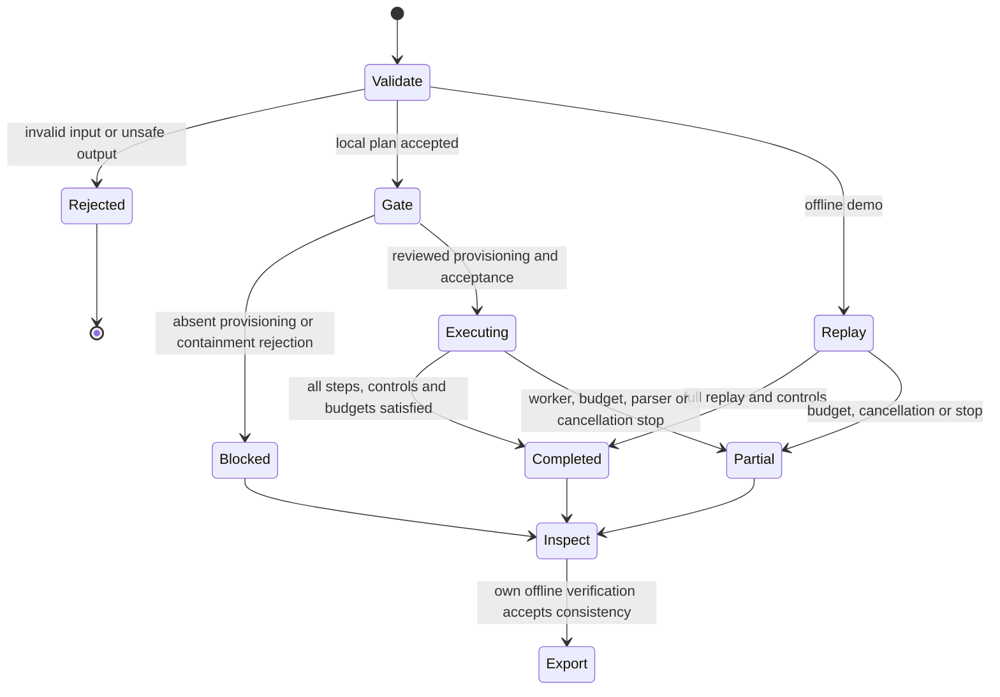

# LabProof operations

## Operational baseline

Run the independent LabProof package with Python 3.12+ and an explicitly selected interpreter. Offline replay/verification/export need no Docker, credentials, model or network. Legacy local execution is a separately provisioned trusted Linux/Docker workflow. **V2 is currently blocked without separate reviewed provisioning.** Codec/Hypothesis source is unregistered and is not an operational capability.

Source paths are relative to the repository root. See `USER-GUIDE.md` for installed and isolated source command prefixes.

## Run lifecycle



`Partial` represents noncomplete statuses such as `incomplete` or `cancelled`, not a literal replacement status. Filesystem failures can leave malformed unfinished directories that fail verification; not every failed command produces a coherent blocked run.

## Before each run

1. Identify the intended package/source revision and domain version. Older wheels may lack new commands despite identical `0.1.0` metadata.
2. Choose unused portable output names; create parent directories first. Never write into a previous run. There is no resume command.
3. Keep incoming artifacts in a separate new directory and do not run their scripts. Verify a static directory; concurrent modification is unsupported.
4. For local execution only, require the approved fixed image/provisioning and fresh live session containment acceptance. `doctor` and `packs` do not test these gates.
5. Do not lower containment standards, enable network, inherit secrets, or run worker fixtures directly on the host to bypass a blocked status.

## Retention and inspection

| Artifact | Operational use |
|---|---|
| `manifest.json` | Project/mode/status, registered file lengths and digests |
| `config.json` | Version, limits, frozen plan/provenance for local v2 |
| `report.json` | Findings, limitations, usage, provenance; v2 experiments and completion |
| `fixture.json` | Exact replay snapshot; not a local-worker artifact |
| `acceptance.json` | Local containment acceptance state/report; not proof against every escape |
| `attempts.json` | V2 controller attempts, including nullable execution ID |
| `executions.json` | Returned local runtime records and parse status |
| `outputs/*.txt` | Retained local worker bytes |
| `evidence/*.json` | Content-bound observations and references |
| `events.jsonl`, `errors.jsonl` | Ordered lifecycle and sanitized failure records |

Retain the complete run, not just the report or exported viewer. V2 manifest remains `1.0`; config/report must remain `local-config-2`/`local-report-2`. Do not edit, normalize, append notes to, or rehash files inside a frozen run. Keep operator notes and exports outside it. Copy the complete directory to archival storage and reverify the copy; unsigned hashes do not replace trusted storage or signatures.

Installed commands, executed individually so expected nonzero states can be inspected:

```sh
python -I -O -m labproof verify-artifacts /absolute/path/run
python -I -m labproof export-viewer /absolute/path/run --output /absolute/path/work/selected-viewer.json
```

Verification returns 0 for complete consistent artifacts, 2 for a supported consistent noncomplete run, and 1 for invalid artifacts. Export can return 0 for that valid blocked/incomplete run and retains its status. It accepts 1–32 own unique run IDs and at most 5 MiB serialized envelope, with exclusive creation outside each run. Reduce selected runs if oversized; never trim raw evidence or modify a manifest to fit.

## Reading v2 explanations

Read run status before finding status. Inspect `completion.required_controls`, `missing_controls`, `all_steps_completed`, and `within_budgets`. Then follow the experiment's request, phase/replay relation, execution identity, controller state, child code, parse status, and observation. A zero exit does not establish an observation; an observation does not establish a finding without host controls.

Compare `usage.tool_attempts` to returned executions and `unreturned_attempts`. Null elapsed time means a controller result was lost, not instantaneous execution. `replays` counts attempted verification steps; `completed_replays` counts parsed returned replays. Null target invocation/rejection/shrink counts are intentionally unmeasured. Containment canary usage is separately bounded and not included in experiment totals.

LabProof does not implement `compare` or temporal claim explanations. Side-by-side report inspection is manual and cannot establish why two real-world results differ.

## Troubleshooting

| Symptom | Check and safe response |
|---|---|
| `experiment-plan` / `export-viewer` unknown | Wrong or older installed package. Check interpreter and approved wheel revision; use explicit intended source prefix for source-only work. |
| `doctor` exits 2 | Expected broader readiness gate; it does not probe local Docker. Do not treat this alone as a broken replay installation. |
| `experiments` exits 2 with blocked artifacts | Inspect absent v2 provisioning and acceptance. Current distribution intentionally has no v2 record; retain this result, do not copy v1 provisioning into its place. |
| Zero-action demo exits 2 | Expected incomplete replay with untested findings. Inspect coherent artifacts using the verifier. |
| Worker returned nonzero / unknown text | Retain raw bytes, parser status and cleanup record. No confirmation; parser changes require reviewed versioned development, not operational relabeling. |
| Missing controls / budget exhausted | Read plan and completion. Use a new approved bounded plan/run; hard limits cannot be increased through imported fields. |
| Unknown/mixed domain version | Use a verifier supporting that exact domain. Never rewrite schema strings or fall back to v1. |
| Hash, identity, replay, or report mismatch | Quarantine static copy; recover original full artifact set from trusted storage. Rehashing is not a repair. |
| Existing/unsafe output or linked path | Select a new ordinary directory/file outside runs, with safe nonlinked ancestors. Do not disable path checks. |
| Oversized export or unsupported browser domain | Export fewer runs or use raw JSON inspection with an appropriate viewer version. Do not downgrade reports. |
| Abrupt filesystem failure | Keep partial directory as diagnostic evidence; verification may reject it. Start a new run; no automatic resume. |

## Safety and assurance

The local controller uses fixed commands/images, no worker network or host mounts/socket/secrets, a read-only root, unprivileged user, dropped capabilities, resource/output bounds, and owned-container cleanup. Rust's reviewed executable scratch policy differs from other packs. Changes to images, provenance, runtime policy, or controls require separate fresh acceptance—not operational workarounds.

Render captured HTML-shaped text literally. Do not open evidence as executable HTML or treat its instructions as operator commands. Findings are synthetic and `public_remediation_claims` is empty; do not forward them as public software lifecycle or remediation facts.

This documentation was checked against source and existing contracts, with no new tests, installation, build, Docker execution, or live validation. Prior source smoke or mocked completed records do not establish fresh wheel acceptance, new tool availability, authentic execution, or production readiness.
